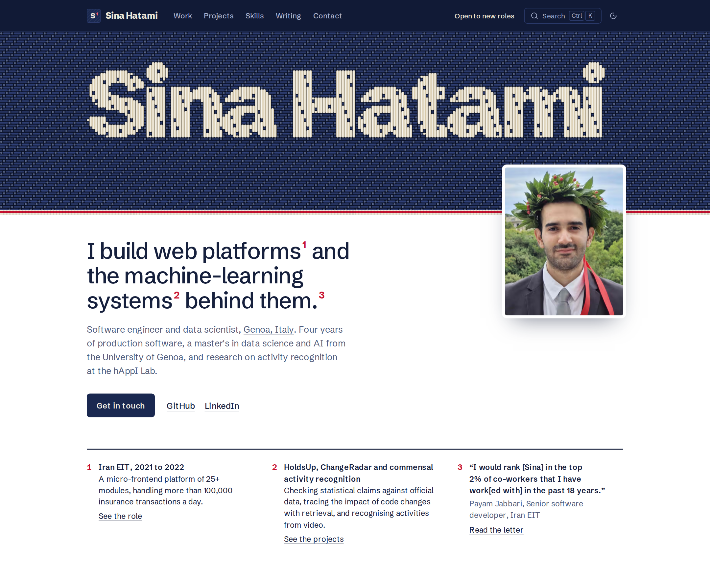

# Sina Hatami — Portfolio

Personal site of Sina Hatami, software engineer and data scientist in Genoa, Italy.

- Live: [sinahatami.vercel.app](https://sinahatami.vercel.app/)
- Source: [github.com/sinahatami/portfolio](https://github.com/sinahatami/portfolio)

[](https://sinahatami.vercel.app/)

## What's on the site

- **Woven name**: the name is woven into a band of indigo twill on a canvas, with real jacquard structures (a twill ground, satin lettering), and the loom picks it in from left to right on load.
- **Sourced headline**: each claim in the opening line carries a numbered note, and the notes underneath give the evidence: the role, the projects, or a sentence quoted from a recommendation letter.
- **Work**: roles and degrees as rows, newest first. Each period is drawn as a bar on one shared timeline, so overlaps and gaps are visible at a glance.
- **Projects**: every public repository, joined with live GitHub data (primary language, last update) and filterable by area: web, machine learning, data and signals, systems and XR. A summary of all public repositories by language closes the section.
- **Skills as evidence**: a loom of skills against the roles and projects that used them. Each skill is a thread, a bar crosses over wherever a role or project used it, and neighbouring uses join into one long bar; the best-evidenced skills come first. Choosing a skill lists its sources with links. Nothing is self-rated; it all comes from the content.
- **References**: recommendation letters quoted verbatim, with the PDF originals.
- **Writing**: articles written in Markdown, at `/blog`.
- **Contact**: a validated form backed by a rate-limited server action and Resend. It sends a notification to the inbox and a confirmation to the visitor.
- **Command palette** (`⌘K` / `Ctrl+K`) and **voice control**, both driven by one command registry.
- Light and dark themes, a print stylesheet for a résumé printout, and keyboard and screen-reader support.

## Design system: "Bleu de Gênes"

Genoa's indigo cloth gave jeans their name, and the jacquard loom's punched cards inspired the first computers, so the site is set like a woven label. The header and footer are denim. At the top of the home page the name is woven into a band of indigo twill: a canvas reads where CSS placed each word, rasterises the letters at thread resolution, and weaves them in ecru satin, picking from left to right on load. A red selvedge line finishes the edge of the cloth. The social image is woven the same way at build time, as SVG.

Below the cloth the pages stay plain, and every claim points to its source. Structure comes from type, rules and rows rather than cards: a 2px rule opens each list and 1px rules separate the rows.

| Token        | Light     | Dark      | Use                                                      |
| ------------ | --------- | --------- | -------------------------------------------------------- |
| Paper        | `#ffffff` | `#0d142b` | Page background                                          |
| Ink          | `#16203d` | `#ebe6da` | Text and rules                                           |
| Muted text   | `#525d7c` | `#a3acc7` | Descriptions, dates, metadata                            |
| Rule         | `#d7dcea` | `#263157` | Row dividers and borders                                 |
| Denim        | `#1a2850` | `#1a2850` | The woven band, header and footer; buttons in light mode |
| Ecru         | `#efe8d8` | `#efe8d8` | The woven name and text on denim                         |
| Selvedge red | `#c8102e` | `#ff5d6e` | Note markers, selected skill, active nav item, focus     |

Apart from the selvedge line, red is reserved for evidence and selection. The type is **Schibsted Grotesk** throughout, with **JetBrains Mono** for code. Kerning is turned off, because this face's kerning opens visible gaps before commas at reading sizes. The icon is the S¹ mark: the initial with a red note number, like the claims in the headline, on a denim tile. All tokens live in [`src/app/globals.css`](src/app/globals.css); the weave is in [`src/lib/weave.ts`](src/lib/weave.ts).

## Architecture

```
src/
├── app/                 Routes (Next.js App Router) — the "pages" of atomic design
├── components/
│   ├── atoms/           Button, Input, Icon, TextLink, Kbd…
│   ├── molecules/       FormField, PeriodLabel, ChoiceChips, ThemeToggle…
│   ├── organisms/       Hero, WovenName, CareerTable, ProjectIndex, SkillsExplorer, ContactForm, CommandPalette…
│   ├── templates/       SiteShell, PageSection, PageIntro, ArticleLayout, StatusLayout
│   └── providers/       Theme and command-center context
├── content/             Typed site content (profile, experience, projects, posts/*.md)
├── domain/              Entities and ports (interfaces) shared by every layer
├── lib/                 Pure logic: dates, career timeline, headline notes, repo matching, skill evidence, weaving, commands
├── server/              Use cases and adapters (GitHub, email, rate limiting, blog, social image)
│   └── container.ts     Composition root — the only place concrete adapters are chosen
├── actions/             Server actions (thin HTTP adapters over use cases)
├── emails/              React Email templates (notification and confirmation)
├── hooks/               Client hooks (scroll spy, speech recognition…)
└── config/              Navigation, site settings, environment access
```

### Principles in practice

- **Single responsibility** — content, pure logic, server use cases and presentation live in separate layers. The contact server action only adapts the request; `ContactService` owns the use case.
- **Open/closed** — sections, navigation and commands are data. Adding a section to `config/navigation.ts` updates the header, scroll spy, command palette and voice control without touching them.
- **Liskov substitution** — atoms accept their native element props, so a `Button` or `Input` can replace the element it wraps.
- **Interface segregation** — ports are small (`EmailSender.send`, `RateLimiter.consume`, `GitHubClient`), and organisms receive only the data they render.
- **Dependency inversion** — use cases depend on interfaces in `domain/` and `server/*`; `server/container.ts` injects the concrete adapters. Pages pass plain props into presentational organisms.

### Patterns

| Pattern            | Where                                                                       |
| ------------------ | --------------------------------------------------------------------------- |
| Repository         | `BlogRepository` → `FileSystemBlogRepository`                               |
| Adapter            | `GitHubRestClient`, `ResendEmailSender`, `useSpeechRecognition`             |
| Strategy           | `RateLimiter` → `FixedWindowRateLimiter` (swap for Redis/KV)                |
| Null Object        | `UnconfiguredEmailSender` when no email provider is configured              |
| Command + Factory  | `buildCommands()` registry consumed by the palette and voice control        |
| Composition root   | `server/container.ts` with lazy singletons                                  |
| Observer           | `useScrollSpy` over `IntersectionObserver`                                  |
| Polymorphic slot   | `Button asChild` via Radix `Slot`                                           |

## Getting started

Requires Node.js 20+ and Yarn 1.

```bash
yarn install
yarn dev
```

Create `.env.local` (all values optional for local development):

```bash
NEXT_PUBLIC_BASE_URL=http://localhost:3000
GITHUB_TOKEN=            # raises the GitHub API rate limit
RESEND_API_KEY=          # without it, the contact form reports that email is not configured
ADMIN_EMAIL=             # inbox for contact messages
FROM_EMAIL=              # verified sender for notifications
REPLY_TO_EMAIL=          # sender for the visitor's confirmation
GOOGLE_VERIFICATION_ID=
```

## Scripts

| Command                 | Purpose                                                             |
| ----------------------- | ------------------------------------------------------------------- |
| `yarn dev`              | Development server (Turbopack)                                      |
| `yarn build`            | Production build                                                    |
| `yarn start`            | Serve the production build                                          |
| `yarn lint`             | ESLint                                                              |
| `yarn type-check`       | TypeScript, strict mode                                             |
| `yarn test`             | Vitest unit and component tests                                     |
| `yarn test:coverage`    | Vitest with V8 coverage                                             |
| `yarn test:e2e`         | Playwright end-to-end tests (desktop and mobile Chrome)             |
| `yarn lighthouse [url]` | Lighthouse scores for mobile and desktop, reports in `.lighthouse/` |
| `yarn knip`             | Find unused files, exports and packages                             |

End-to-end tests and Lighthouse run against the production build, so run
`yarn build` first. Playwright starts the server itself; for Lighthouse, run
`yarn start` in another terminal. The first Playwright run needs a browser:
`yarn playwright install chromium`.

## Contact

Sina Hatami — [hatamisinaa@gmail.com](mailto:hatamisinaa@gmail.com) · [LinkedIn](https://www.linkedin.com/in/sina-hatami/) · [GitHub](https://github.com/sinahatami)

## License

MIT
